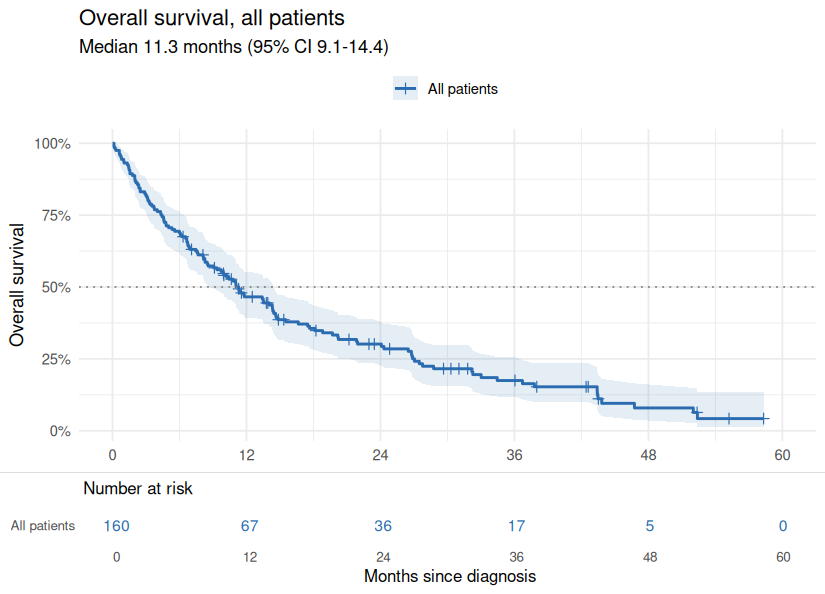
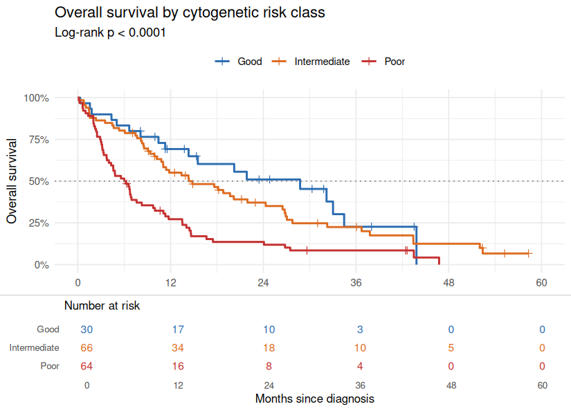
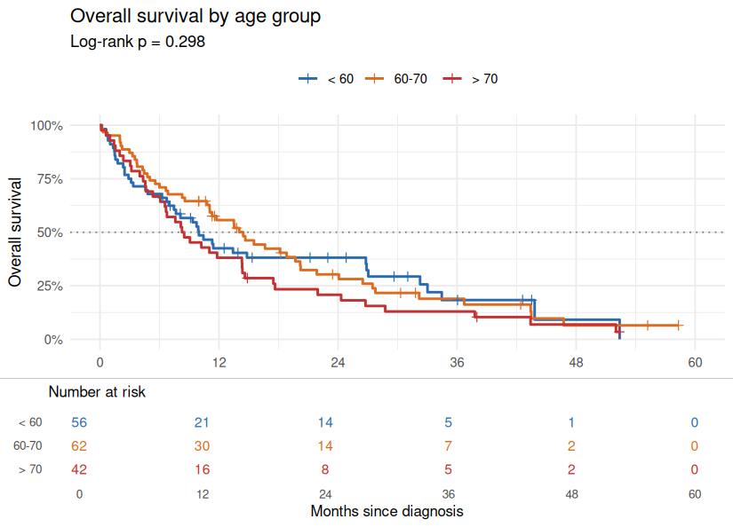
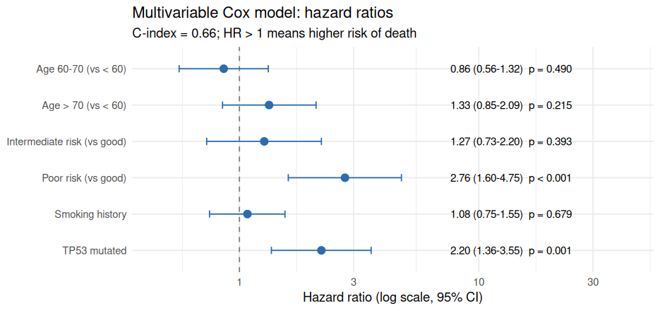

# Survival analysis: Kaplan–Meier and Cox regression (R)


[](https://github.com/alex-sukhoi/survival-analysis-km-cox/actions/workflows/reproduce.yml)

An overall-survival analysis of the kind requested for clinical papers and registry reports:
Kaplan–Meier curves with numbers at risk, median survival with confidence intervals, log-rank
tests, and a Cox proportional hazards model with a forest plot and a check of the proportional
hazards assumption.

> **Data:** synthetic. 160 patients from a simulated haematological-oncology cohort (Weibull
> proportional-hazards model with censoring), generated in `R/01_simulate_data.R`. No patient data
> are used.

## Questions

1. What is the overall survival of the cohort?
2. Does survival differ by **age group** (< 60, 60–70, > 70) and by **cytogenetic risk class**
   (good, intermediate, poor)?
3. Which factors (age, cytogenetic risk, smoking history, TP53 mutation) independently predict death?

## Results

### Overall survival
<p align="center"></p>

129 of 160 patients (81%) died during follow-up. Median overall survival was **11.3 months
(95% CI 9.1–14.4)**. Survival was 46.6% at 1 year, 30.2% at 2 years and 17.5% at 3 years.

### By cytogenetic risk class and by age group
<p align="center">
  
  
</p>

| Group | n | Deaths | Median OS, months (95% CI) | Log-rank |
|---|---|---|---|---|
| Good risk | 30 | 18 | 28.8 (14.3–NR) | |
| Intermediate risk | 66 | 52 | 14.4 (11.0–24.3) | p < 0.0001 |
| Poor risk | 64 | 59 | 6.1 (4.3–8.3) | |
| Age < 60 | 56 | 41 | 10.0 (7.5–26.9) | |
| Age 60–70 | 62 | 49 | 14.4 (11.1–20.2) | p = 0.298 |
| Age > 70 | 42 | 39 | 8.4 (6.6–14.4) | |

NR = not reached. Cytogenetic risk separates the curves clearly. Age groups do not differ
significantly, although patients over 70 have the shortest median survival.

### Cox proportional hazards model
<p align="center"></p>

| Factor | Univariable HR (95% CI) | Multivariable HR (95% CI) | p (multivariable) |
|---|---|---|---|
| Age 60–70 vs < 60 | 0.93 (0.61–1.41) | 0.86 (0.56–1.32) | 0.490 |
| Age > 70 vs < 60 | 1.29 (0.83–2.00) | 1.33 (0.85–2.09) | 0.215 |
| Intermediate vs good risk | 1.35 (0.78–2.31) | 1.27 (0.73–2.20) | 0.393 |
| **Poor vs good risk** | 2.83 (1.66–4.82) | **2.76 (1.60–4.75)** | **< 0.001** |
| Smoking history | 1.04 (0.73–1.47) | 1.08 (0.75–1.55) | 0.679 |
| **TP53 mutated** | 2.73 (1.74–4.30) | **2.20 (1.36–3.55)** | **0.001** |

- **Poor cytogenetic risk** almost triples the hazard of death, and a **TP53 mutation** doubles it,
  after adjusting for the other factors.
- Model discrimination: C-index 0.66; likelihood-ratio test p < 0.001.
- **Proportional hazards assumption** (Schoenfeld residuals): no violation for any factor
  (global p = 0.576).

## Repository structure

```
R/01_simulate_data.R        synthetic cohort (Weibull PH model with censoring)
R/02_survival_analysis.R    descriptives, KM + log-rank, Cox models, PH test, figures
results/                    descriptive table, medians, 1-3 year survival, HRs, PH test, C-index
figures/                    KM curves with numbers at risk, forest plot
```

## How to run

```r
install.packages(c("survival", "ggplot2", "gridExtra", "scales"))
source("run_all.R")
```

## References

- Kaplan, E. L., & Meier, P. (1958). Nonparametric estimation from incomplete observations. *JASA, 53*(282), 457–481.
- Cox, D. R. (1972). Regression models and life-tables. *Journal of the Royal Statistical Society B, 34*(2), 187–220.
- Grambsch, P. M., & Therneau, T. M. (1994). Proportional hazards tests and diagnostics based on weighted residuals. *Biometrika, 81*(3), 515–526.
- Therneau, T. M., & Grambsch, P. M. (2000). *Modeling survival data: Extending the Cox model*. Springer.

---
**Author:** [Oleksii Sukhoi](https://github.com/alex-sukhoi), statistician and data analyst · [LinkedIn](https://www.linkedin.com/in/oleksii-sukhoi-4b60161a7)
